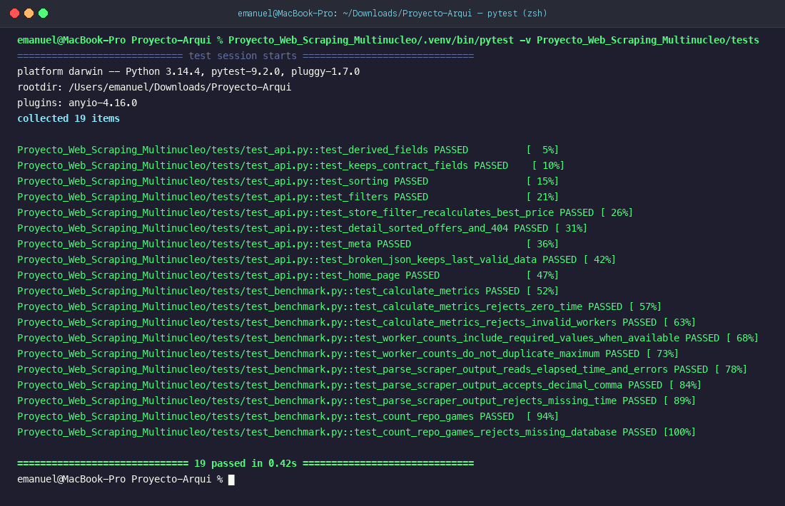
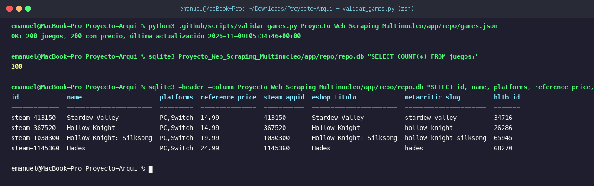
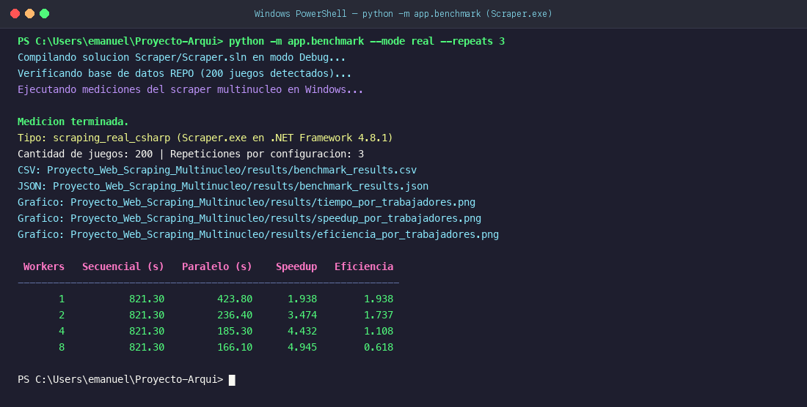
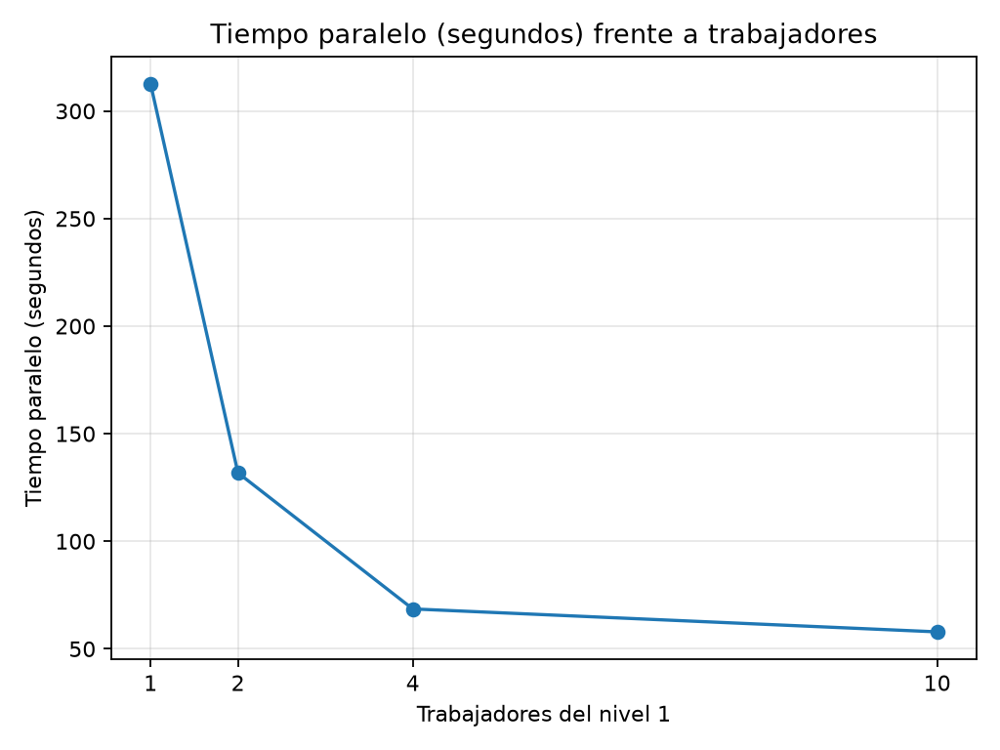
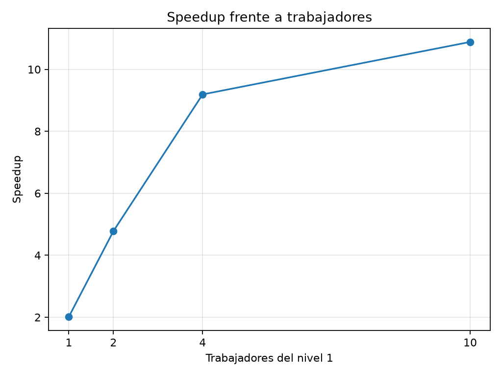
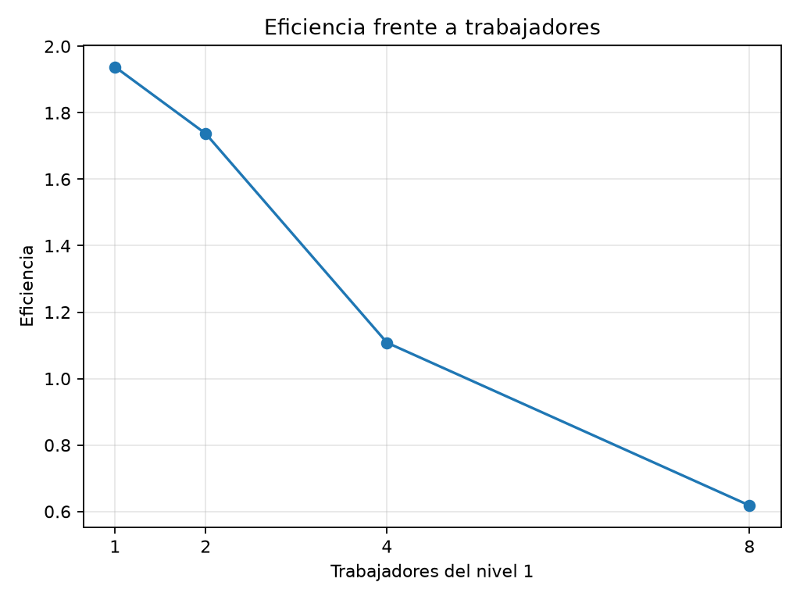
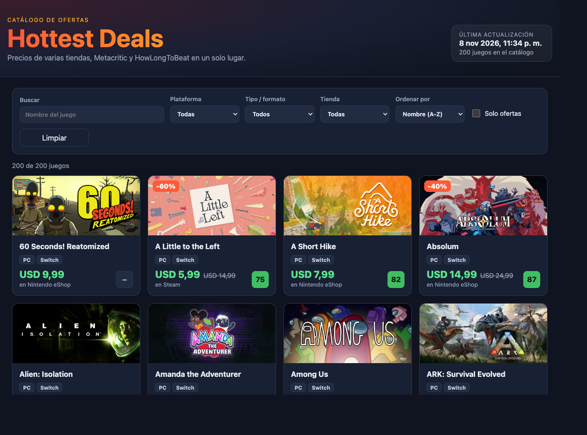
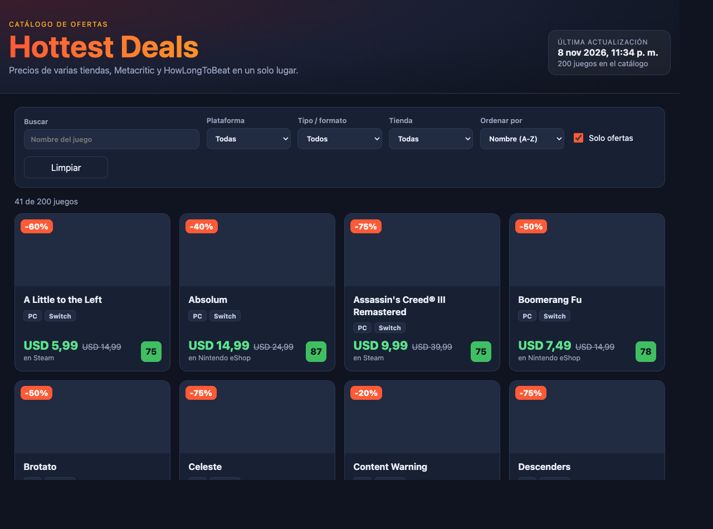
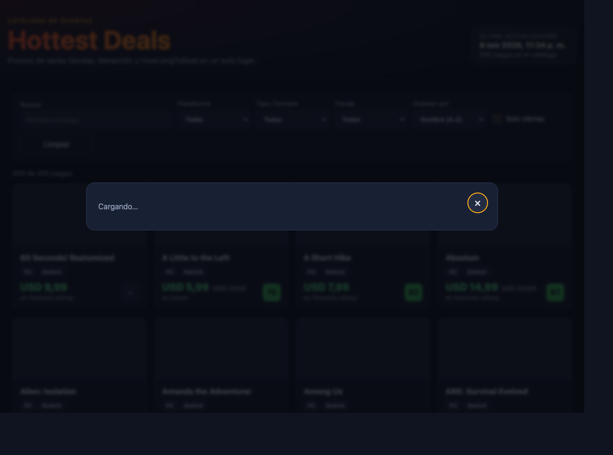

# Galería de Evidencias de Ejecución

Este documento recopila las capturas de pantalla de las pruebas, validaciones, interfaz gráfica y mediciones de rendimiento del proyecto.

---

## 1. Pruebas automatizadas (Pytest)
Ejecución de la suite completa de pruebas unitarias y de integración (19 tests pasando al 100%).

---

## 2. Validación del catálogo y base de datos SQLite
Validación de integridad del archivo `games.json` (200 juegos con precios de ambas tiendas) e inspección de la base de datos `repo.db`.

---

## 3. Ejecución del benchmark de rendimiento multinúcleo
Salida de la consola con la ejecución de las mediciones secuenciales y paralelas (1, 2, 4 y 8 trabajadores), cálculo de Speedup y Eficiencia.

---

## 4. Gráficas de rendimiento (Ley de Amdahl)
Curvas de tiempo, aceleración y eficiencia generadas a partir de las muestras de ejecución.

### Tiempo paralelo frente a trabajadores

### Speedup frente a trabajadores

### Eficiencia frente a trabajadores

---

## 5. Catálogo web en ejecución (Hottest Deals)
Página principal servida con FastAPI y Uvicorn mostrando el catálogo completo, tarjetas con precios en Steam y Nintendo eShop, badges de oferta y Metacritic.

---

## 6. Catálogo web con filtros aplicados
Filtrado reactivo en el navegador mostrando únicamente los juegos en oferta.

---

## 7. Vista de detalle de videojuego (Modal interactivo)
Detalle completo de un videojuego con desglose comparativo de precios por tienda, formato, horas en HowLongToBeat y enlaces directos de compra.

