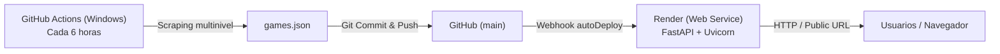

# Publicación y despliegue del catálogo

El catálogo web se publica en la nube utilizando **Render** y se mantiene actualizado automáticamente mediante **GitHub Actions**.

---

## 1. Arquitectura de despliegue



1. **Scraping periódico:** Cada 6 horas, una máquina virtual Windows en GitHub Actions compila y ejecuta `Scraper.exe`, valida los datos con `.github/scripts/validar_games.py` y sube los cambios de `games.json` a la rama `main`.
2. **Auto-Deploy en Render:** Render detecta el nuevo commit en `main` y activa el despliegue automático del servicio web.
3. **Persistencia y memoria:** Como `games.json` está dentro del repositorio, la web siempre arranca con los datos más recientes y los sirve de forma instantánea sin requerir bases de datos remotas adicionales.

---

## 2. Configuración en Render (`render.yaml`)

El servicio está configurado como Infrastructure as Code mediante [`render.yaml`](../../render.yaml) en la raíz:

```yaml
services:
  - type: web
    name: hottest-deals
    runtime: python
    plan: free
    rootDir: Proyecto_Web_Scraping_Multinucleo
    buildCommand: pip install -r requirements.txt
    startCommand: uvicorn app.main:app --host 0.0.0.0 --port $PORT
    healthCheckPath: /health
    autoDeploy: true
```

* **Runtime:** Python 3.11+.
* **Build Command:** `pip install -r requirements.txt` instala FastAPI, Uvicorn, Jinja2, etc.
* **Start Command:** Levanta el servidor en `0.0.0.0` en el puerto asignado dinámicamente por la variable `$PORT`.
* **Health Check:** Monitorea la ruta `/health` para garantizar que la app responde con `{"status": "ok"}` antes de enrutar tráfico.

---

## 3. Pasos para publicar por primera vez en Render

1. Entrar a [dashboard.render.com](https://dashboard.render.com) e iniciar sesión con la cuenta de GitHub.
2. Hacer clic en **New +** y seleccionar **Blueprint** (o **Web Service**).
3. Seleccionar el repositorio `Proyecto-Arqui`.
4. Render leerá automáticamente el archivo `render.yaml` y creará el servicio `hottest-deals`.
5. Una vez finalizado el build, Render proporcionará una URL pública (por ejemplo: `https://hottest-deals.onrender.com`).

---

## 4. Variables de entorno opcionales

| Variable | Valor por defecto | Descripción |
|---|---|---|
| `PORT` | Asignado por Render (ej. 10000) | Puerto en el que escucha el servidor Uvicorn. |
| `CURRENCY` | `USD` | Moneda mostrada en el catálogo y retornada en `/api/meta`. |
| `GAMES_DATA_FILE` | `app/repo/games.json` | Ruta relativa o absoluta a un archivo de datos alternativo (útil en pruebas). |

---

## 5. Actualización en tiempo real en el cliente

El cliente web ([`app.js`](../app/static/app.js)) consulta periódicamente el endpoint `/api/meta` cada 5 minutos (`REFRESH_MS = 300000`). Si detecta que `data_version` cambió (nueva fecha de modificación en `games.json`), refresca el catálogo automáticamente en pantalla sin perder los filtros activos del usuario.
