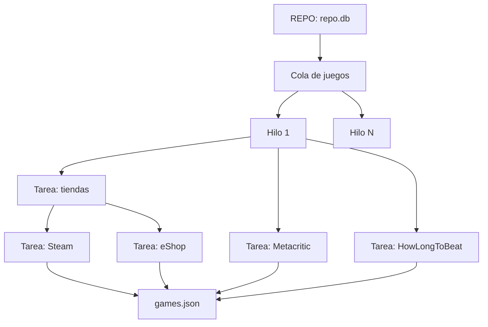

# REPO y web scraping (Integrante 1)

El scraper está hecho en C# (consola, .NET Framework 4.8.1) y está en `Scraper/`. Se comunica con la web por medio de `games.json`.

## Paralelismo



En el nivel 1, N hilos (`Thread`) sacan juegos de una `ConcurrentQueue` y cada uno procesa su juego completo. En el nivel 2, las tiendas, Metacritic y HowLongToBeat corren cada una en un `Task.Run`. En el nivel 3 pasa lo mismo con Steam y el eShop. En los dos casos se espera con `Task.WhenAll`.

Usamos hilos en el nivel 1 porque cada juego es un trabajo independiente y largo. Además, los hilos comparten la memoria, así que todos usan el mismo `HttpClient` y los mismos límites por sitio. En los niveles 2 y 3 casi todo es esperar a la red. Una tarea del ThreadPool que espera no ocupa un hilo, y cuando llega la respuesta se procesa en el núcleo que esté libre.

La cantidad de hilos se escoge con `--workers N` (por defecto `Environment.ProcessorCount`). Más hilos no siempre es más rápido, porque cada sitio tiene un límite de solicitudes y la red no mejora con más núcleos. Eso hay que tomarlo en cuenta con la Ley de Amdahl.

Para sincronizar usamos varias cosas:
- La `ConcurrentQueue`, para que dos hilos no tomen el mismo juego.
- Un `SemaphoreSlim` por sitio (Steam 4, eShop 4, Metacritic 2, HLTB 2).
- Un `lock` al escribir el log de errores.
- `Join` y `Task.WhenAll` para esperar.

El arreglo de resultados no necesita `lock`, porque cada hilo escribe solo en la posición de su juego.

`--secuencial` usa los mismos métodos, pero un juego, una fuente y una tienda a la vez. En una prueba con 3 juegos dio los mismos datos que la paralela: 5,1 s contra 1,6 s con 4 hilos. La corrida completa de los 200 juegos con 12 hilos tardó entre 160 y 170 s, sin errores. Lo más lento es Metacritic, porque cada página pesa unos 700 KB y solo se hacen 2 consultas a la vez.

## REPO

Es una base de datos SQLite local, `app/repo/repo.db`, con una tabla `juegos` (una fila por juego). El programa la lee en cada corrida con `SELECT * FROM juegos`, así que para agregar o quitar juegos basta con editar la tabla, por ejemplo con DB Browser for SQLite, sin tocar el código. Cada juego tiene estos campos:
- los del contrato: `id`, `name`, `platforms`, `release_date`, `reference_price` (precio regular de Steam) e `image_url`;
- los que sirven para llegar directo al juego en cada sitio: `steam_appid`, `eshop_titulo`, `metacritic_slug` y `hltb_id`.

Buscar solo por nombre falla fácil. Si uno busca "Hades" en el eShop, salen primero "Hades II" y sus ediciones.

El REPO se arma con `--generar-repo`. El programa recorre el catálogo del eShop por popularidad y se queda con los juegos que también están en Steam con el mismo nombre y con precio. Al principio era lentísimo, porque los primeros del eShop son casi todos de Nintendo y no están en Steam. Lo resolvimos filtrando los juegos publicados por Nintendo, y con eso 33 de los primeros 40 candidatos sí estaban en Steam. El generador no sobrescribe un REPO que ya existe.

## Cómo se consulta cada sitio

Todos los precios están en USD. Esto se saca de cada sitio:
- **Steam:** de `api/appdetails?appids=<id>&cc=us` (JSON) salen el precio actual y el regular.
- **eShop:** el buscador de nintendo.com (Algolia) se consulta por el título exacto. La clave se lee de `.env`, que no se sube a GitHub.
- **Metacritic:** de la página `metacritic.com/game/<slug>/` se lee el bloque `__NUXT_DATA__` y se busca el score de PC. Si PC no tiene score, se usa el de Switch.
- **HowLongToBeat:** de `howlongtobeat.com/game/<id>` se lee `comp_main` del bloque `__NEXT_DATA__` y se pasa a horas. 190 de los 200 juegos tienen ese dato; a los demás HowLongToBeat no les tiene tiempo registrado.

Un juego está en oferta cuando su mejor precio es menor que el precio regular de esa misma tienda. Con eso se calcula `discount_percent` en `repository.py`.

Hay dos cosas que decidimos y que conviene explicar:
- Todo el formato es `digital`, porque las dos tiendas solo venden digital. Probamos Amazon y Best Buy, pero ninguno respondió bien.
- El contrato tiene un solo campo para el score de Metacritic, y el score cambia según la plataforma (Hollow Knight: 87 en PC, 90 en Switch). Usamos el de PC. Si PC no tiene, porque pocos críticos la reseñaron, usamos el de Switch, que es la otra plataforma del REPO. Con eso, 166 de los 200 juegos tienen score.

## Errores

Cada solicitud tiene 20 s de timeout y hasta 3 intentos, con 1 s y luego 2 s de espera. Si llega un 429, se respeta `Retry-After`. Un 404 no cuenta como error, solo deja el dato en `null`. Si una fuente falla, se conserva el dato anterior del `games.json`, el error se anota en `Scraper/logs/errores.csv` y el lote sigue. El archivo se escribe primero en un temporal, para que la web nunca lea uno a medias.

Lo probamos rompiendo la clave del eShop. El lote terminó, quedaron 3 errores registrados y se mantuvieron los precios anteriores.

## Ejecución

```bash
dotnet build Scraper/Scraper.sln
Scraper/Scraper/bin/Debug/net481/Scraper.exe --generar-repo
Scraper/Scraper/bin/Debug/net481/Scraper.exe --workers 4
Scraper/Scraper/bin/Debug/net481/Scraper.exe --secuencial
```

`--limite K` procesa solo K juegos. Al final se imprime `Tiempo total: X s` para el benchmark.

## Actualización

GitHub Actions corre el scraper cada 6 horas en una máquina Windows, revisa el `games.json` y lo sube a `main`, y Render vuelve a publicar la página. Escogimos 6 horas porque los precios de Steam y el eShop cambian una o dos veces al día, el scraping dura menos de 3 minutos y 4 corridas al día es poca carga para los sitios. Las claves del eShop están en los Secrets del repositorio. Si falta el `.env` o el REPO, el programa termina con código 1, para que la corrida salga como fallida en vez de pasar sin hacer nada.
